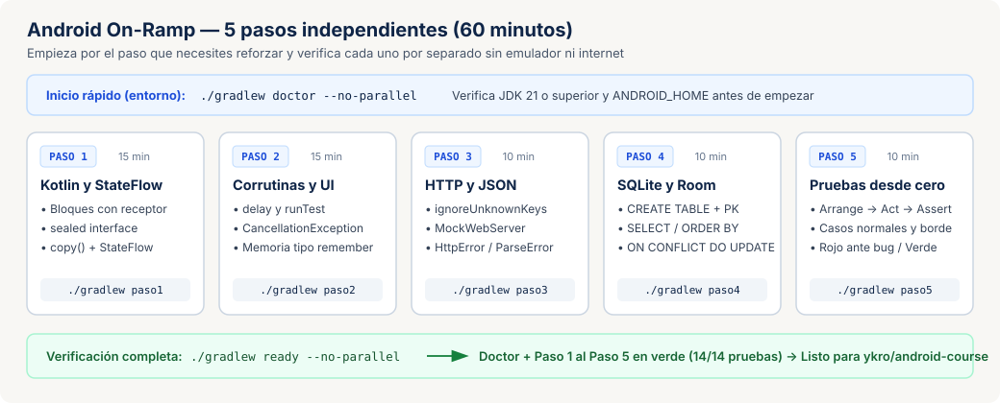

# Android On-Ramp

Este repositorio es un on-ramp, una nivelación práctica para llegar con lo mínimo al [curso de Android](https://github.com/ykro/android-course). Está pensado para estudiantes que ya programan (estructuras de datos, algoritmos, orientación a objetos, casi siempre en Java) pero no han usado Kotlin moderno ni una base de datos. Todo corre en tu computadora con Gradle y tests de JUnit, sin emulador y sin cuentas externas.

## Por dónde empezar

Si es tu primera vez con Kotlin, sigue los pasos del 0 al 5 en orden; el recorrido completo toma unas dos horas y media. Si ya usas Kotlin, haz el Paso 0 de todas formas (son minutos y confirma tu JDK y tu Android SDK) y luego elige el paso que necesites, porque cada uno se verifica por separado.

Cada paso sigue la misma forma. Empieza con tres preguntas para pensar antes de tocar código, explica por qué importa para el curso, te pide leer, depurar y escribir algo pequeño, y cierra con preguntas sobre un caso nuevo. Si te trabas, cada paso tiene tres pistas que van de la idea general a un esqueleto de código.

| Paso | Tiempo | Qué practicas | Archivo | Guía |
| --- | --- | --- | --- | --- |
| Paso 0 | 25 min | Revisar JDK y Android SDK con `doctor`, y Kotlin básico (tipos nulos, `data class`, `filter`/`map`, `when`) | [PrimerosPasos.kt](m0-doctor/src/main/kotlin/onramp/m0/PrimerosPasos.kt) | [steps/00-entorno-y-kotlin](steps/00-entorno-y-kotlin/README.md) |
| Paso 1 | 30 min | Lambdas con receptor (la sintaxis de Compose y Koin), `sealed interface` y `StateFlow` inmutable | [DslBuilders.kt](m1-kotlin-dsl-estado/src/main/kotlin/onramp/m1/DslBuilders.kt), [OrderState.kt](m1-kotlin-dsl-estado/src/main/kotlin/onramp/m1/OrderState.kt) | [steps/01-kotlin-y-stateflow](steps/01-kotlin-y-stateflow/README.md) |
| Paso 2 | 25 min | `suspend` y `delay` con reloj virtual, cancelación y estado que sobrevive al redibujo | [CoroutinesAndUi.kt](m2-corrutinas-y-ui/src/main/kotlin/onramp/m2/CoroutinesAndUi.kt) | [steps/02-corrutinas-y-ui](steps/02-corrutinas-y-ui/README.md) |
| Paso 3 | 20 min | Requests con OkHttp, JSON tolerante a campos nuevos y errores HTTP o de parseo con `MockWebServer` | [BookApiClient.kt](m3-http-y-sql/src/main/kotlin/onramp/m3/BookApiClient.kt) | [steps/03-http-json](steps/03-http-json/README.md) |
| Paso 4 | 30 min | Tu primera base de datos, tablas, llave primaria, `SELECT` y `ON CONFLICT DO UPDATE` en SQLite, y su equivalente en Room 3 | [BookDatabase.kt](m3-http-y-sql/src/main/kotlin/onramp/m3/BookDatabase.kt) | [steps/04-sql-y-upsert](steps/04-sql-y-upsert/README.md) |
| Paso 5 | 20 min | Tests desde cero con JUnit que se ponen en rojo ante una versión con un bug | [ReadingStreakStudentTest.kt](m4-pruebas-desde-cero/src/test/kotlin/onramp/m4/ReadingStreakStudentTest.kt) | [steps/05-pruebas-desde-cero](steps/05-pruebas-desde-cero/README.md) |

## Inicio rápido

1. Instala [Android Studio](https://developer.android.com/studio), que trae JDK 21 y el Android SDK, y clona este repositorio.
2. Corre `./gradlew doctor --no-parallel` (en Windows, `gradlew.bat doctor --no-parallel`) y sigue lo que te pida.
3. Sigue el [Paso 0](steps/00-entorno-y-kotlin/README.md). `./gradlew :m0-doctor:run --no-parallel` corre tu primer programa en Kotlin.
4. Verifica cada paso con `./gradlew paso0 --no-parallel` hasta `./gradlew paso5 --no-parallel`. `./gradlew ready --no-parallel` corre los seis juntos.

Al inicio todos los pasos fallan a propósito; cada uno pasa cuando lo resuelves. Cuando `ready` termina en verde, estás listo para el curso.

## Errores comunes al preparar el entorno

| Lo que ves | Qué significa | Qué hacer |
| --- | --- | --- |
| `[FALTA] JDK detectado: 17...` | Gradle corre con un JDK viejo | Instala JDK 21 (viene con Android Studio) y apunta `JAVA_HOME` a él. En macOS con Android Studio: `export JAVA_HOME="/Applications/Android Studio.app/Contents/jbr/Contents/Home"` |
| `[FALTA] No se encontró un Android SDK válido` | No hay SDK instalado o `ANDROID_HOME` apunta a otra carpeta | Abre Android Studio, **Settings**, **Android SDK**, instala una plataforma y exporta `ANDROID_HOME` como indica `doctor` |
| `./gradlew: Permission denied` | El script perdió el permiso de ejecución al copiarse | `chmod +x gradlew` |
| La primera corrida tarda varios minutos | Gradle descarga su propia versión y las dependencias | Es normal la primera vez; las siguientes son rápidas |
| `Could not resolve ...` | No hay internet o un proxy bloquea Maven Central | Conéctate y vuelve a correr el comando; después de la primera descarga ya no hace falta red |

## Lecturas cortas y uso de IA

- El [glosario](docs/glosario.md) explica cada término con un enlace a la documentación oficial.
- [Cómo leer un ADR](docs/adr-ejemplo.md) te prepara para el `ARCHITECTURE_DECISIONS.md` del curso.
- [Qué es la Integración Continua (CI)](docs/ci.md) explica qué corre GitHub Actions cuando haces push.
- [Firebase en la Unidad 3](docs/firebase.md) adelanta Firebase Auth, Firestore con `callbackFlow` y `firestore.rules`.
- Puedes usar tu asistente de IA (Claude Code, Antigravity, Codex o Gemini CLI). [AGENTS.md](AGENTS.md) le pide que te guíe con preguntas y pistas antes de mostrarte código. Si aceptas código que no puedes explicar con tus palabras, el on-ramp pierde su sentido.

## Repositorios relacionados

- Índice de on-ramps: [ykro/courses-onramp](https://github.com/ykro/courses-onramp)
- Curso principal: [ykro/android-course](https://github.com/ykro/android-course)
- Solución de referencia, con las respuestas de autoevaluación de cada paso: [ykro/android-onramp-solution](https://github.com/ykro/android-onramp-solution)
